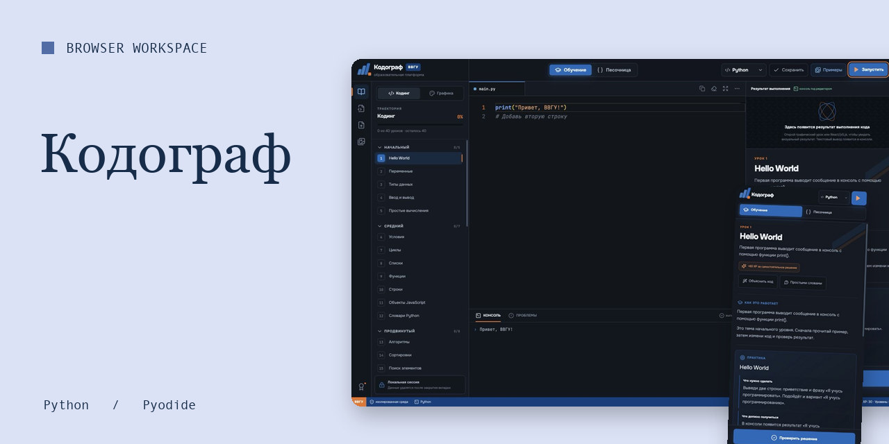
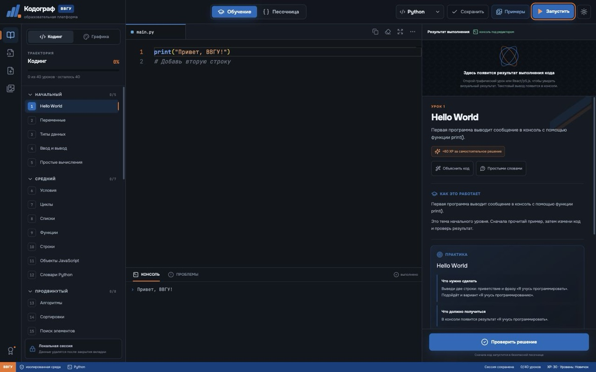
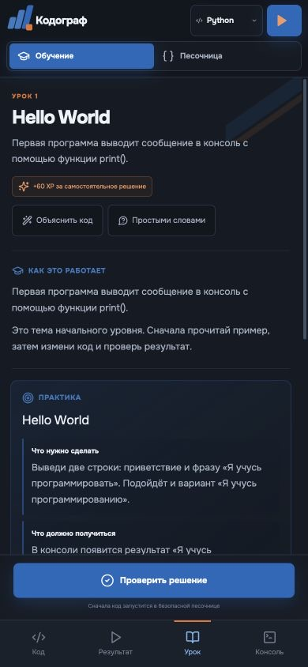
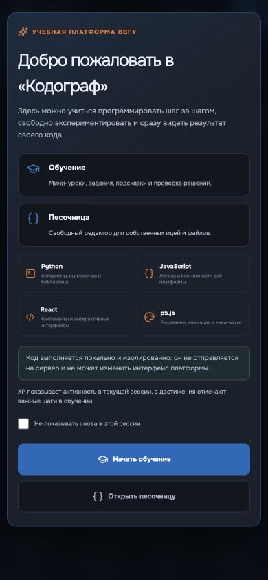

# Кодограф ВВГУ

Учебная среда для Python. Студент читает задание, редактирует код и видит результат запуска в той же вкладке.

Проверен локально · Публичная витрина приватного проекта  
Next.js · Monaco Editor · Pyodide · Web Worker

## От урока до вывода Python

**Редактор.** В условии остаются объяснение и пример. Решение можно набрать в Monaco Editor, проверить и затем поэкспериментировать в отдельной песочнице.

**Выполнение.** Pyodide запускает Python в Web Worker. Пока интерпретатор работает, основной поток браузера обслуживает интерфейс. Проверка задания выполняется на стороне клиента.

Самостоятельный учебный концепт. ВВГУ упоминается в названии проекта, официального статуса у сервиса нет.

## Python на двух экранах

**[Условие на телефоне](assets/screen-lesson-mobile.jpg)** · В уроке Hello World можно прочитать задание и пример перед переходом к решению.

**[Редактор на компьютере](assets/screen-python-run-desktop.jpg)** · Условие остаётся справа от кода. Под редактором видно место для вывода Python, поэтому результат можно сверить с примером в той же вкладке.

Развернуть галерею

[Примечание о проекте](NOTICE.md) · [Профиль](https://github.com/mrjakeball) · [Каталог проектов](https://github.com/mrjakeball/portfolio)
