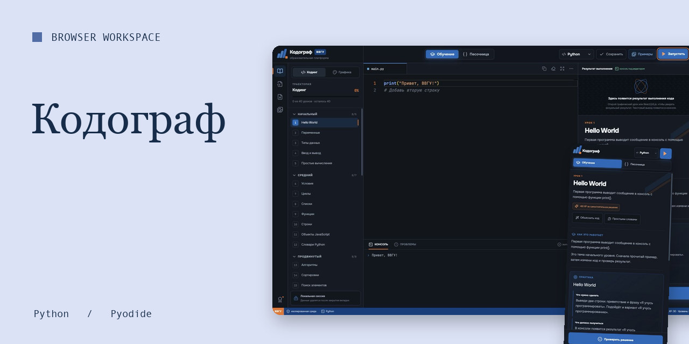
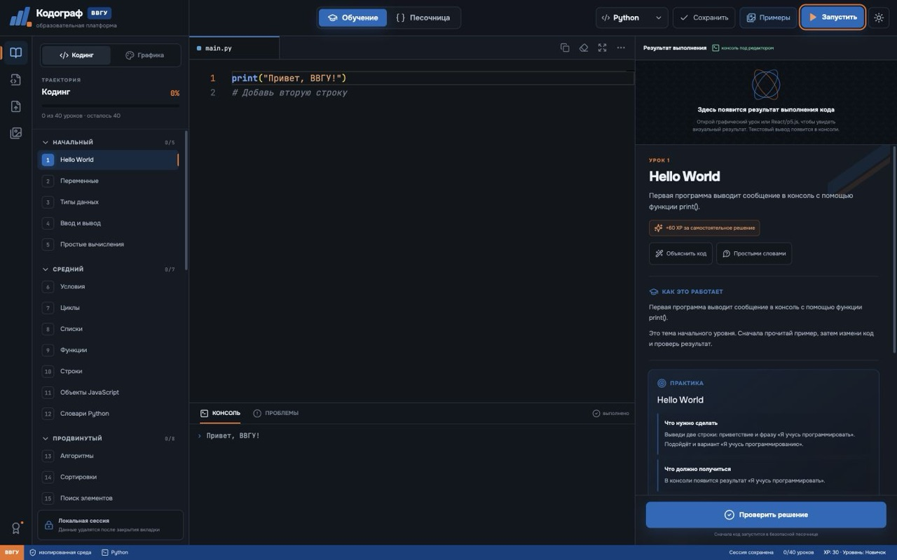
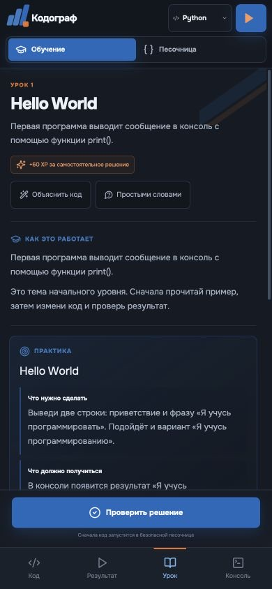
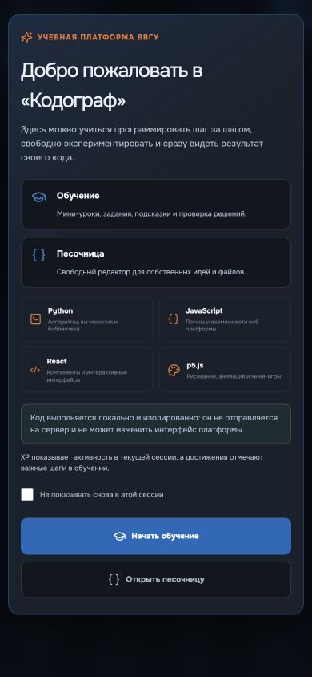

[RU](README.md) · **EN**　 /　 [Profile](https://github.com/mrjakeball/mrjakeball/blob/main/README_EN.md) · [Project catalogue](https://github.com/mrjakeball/portfolio/blob/main/README_EN.md)

# Kodograf VVGU

A browser workspace for learning Python. The student reads a task, edits code and sees its output in the same tab.

Locally evaluated prototype · Public showcase of a private project  
Next.js · Monaco Editor · Pyodide · Web Worker

## From the lesson to Python output

**Editing.** The explanation and example stay beside Monaco Editor. Students can check their solution and then experiment in a separate sandbox.

**Execution.** Pyodide runs Python in a Web Worker. The main browser thread remains available for the interface while the interpreter runs. Exercise checking happens on the client.

An independent educational concept using the VVGU name, with no official university affiliation.

## Original images

[Editor and execution output](assets/screen-python-run-desktop.jpg) · [Mobile lesson](assets/screen-lesson-mobile.jpg) · [Welcome screen](assets/screen-welcome-mobile.jpg)

View the gallery

[Project notice](NOTICE.md) · [Profile](https://github.com/mrjakeball/mrjakeball/blob/main/README_EN.md) · [Project catalogue](https://github.com/mrjakeball/portfolio/blob/main/README_EN.md)
